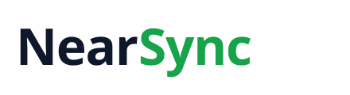

  <picture>
    <source media="(prefers-color-scheme: dark)" srcset="assets/nearsync-wordmark-dark.svg">
    
  </picture>

<h3 align="center">We make fragmented software whole.</h3>

One system for every department, with human-first AI across all of it. 
Built in the UAE for emerging companies, wherever their people work.

  <a href="https://nearsync.ai">Website</a> ·
  <a href="https://docs.nearsync.ai">Documentation</a> ·
  <a href="https://nearsync.ai/changelog/">Changelog</a> ·
  <a href="https://nearsync.ai/careers/">Careers</a> ·
  <a href="https://nearsync.ai/contact/">Contact</a>

---

### One system, not five

Sales, communications, finance, people and operations work together in one place, on one record of the business. A customer lives in one database, not four, and a new joiner learns one system, not five.

### Each customer's data is kept apart

Customers' data is separated by organisation in the database itself: every table has row-level access rules that decide what each person can read or change, and we are proving those rules one by one with automated checks that try to cross from one organisation into another. How we process data is set out in our [Data Processing Agreement](https://nearsync.ai/legal/dpa/) and [Privacy Policy](https://nearsync.ai/legal/privacy/).

### Every release is tested before it reaches you

Production changes through one gated release. Automated tests, a check that the database can be rebuilt from scratch, and end-to-end tests with real sign-in all have to pass first, and only a release that passed is promoted. Release notes are published in the [changelog](https://nearsync.ai/changelog/).

### Human first, responsible AI

We use AI to make working life better, not merely busier. It enriches the data a business runs on and takes the upkeep of that data off people who have better things to do with their day.

### How we work

- **We run on NearSync.** Our own company works inside the product every day. It is the fastest way we know to find what is missing.
- **Everyone owns a surface.** No layers between the person building something and the person who needs it.
- **We say the limits out loud.** We state what a thing does not do yet before anyone has to find it, and we would rather be exact than impressive.
- **We measure work, not screens.** Remote first, with no monitoring of anyone.

---

### Report a security issue

Email **security@nearsync.ai** with what you found, how to reproduce it, and the impact you expect. Please do not open a public issue or test against other customers' data. We acknowledge reports promptly and keep you informed until the issue is resolved.

### Why our code is private

The NearSync platform is proprietary. This organisation is where our team builds it; our public legal terms are at [nearsync.ai/legal](https://nearsync.ai/legal/terms/).
